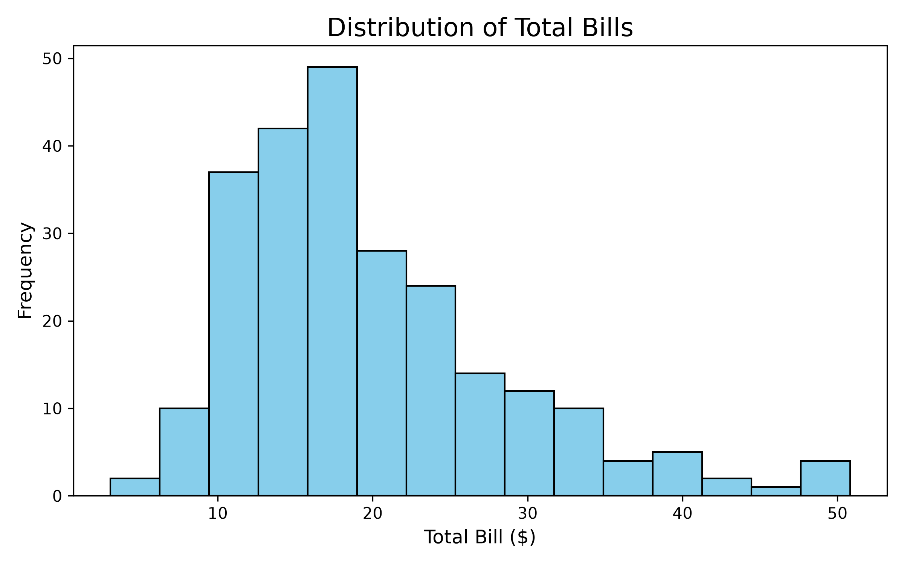
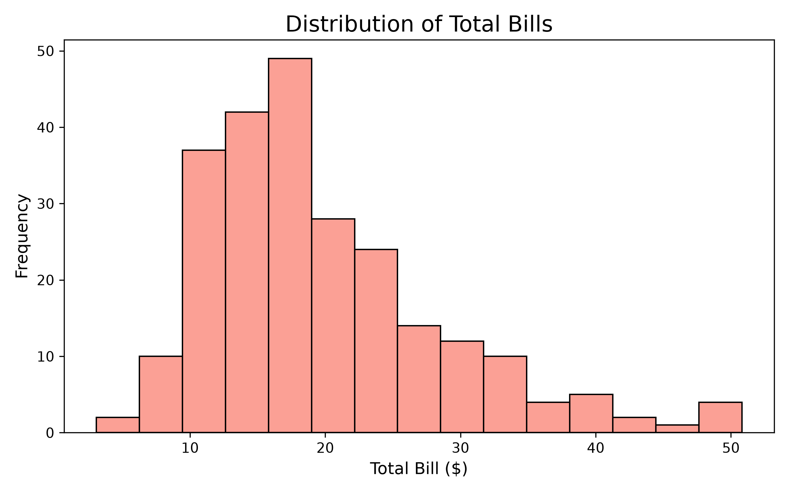
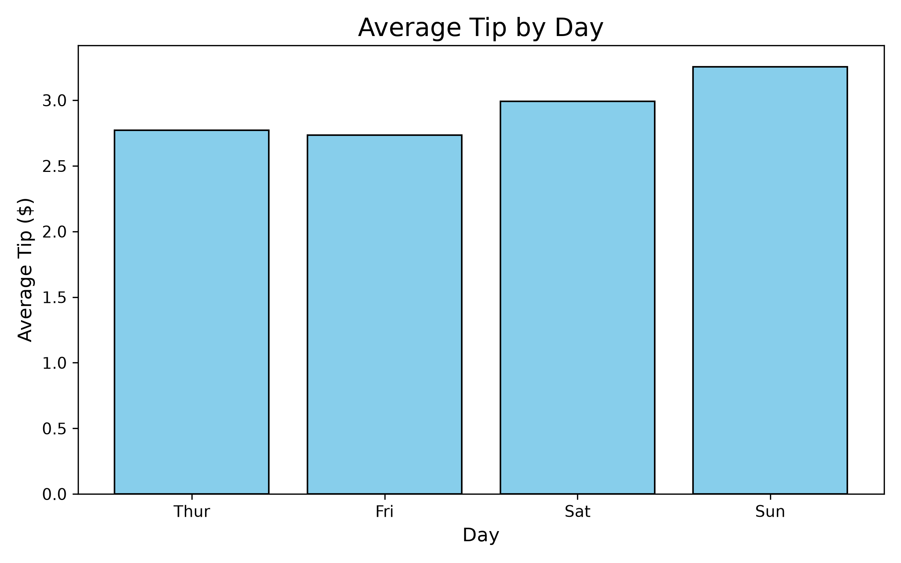
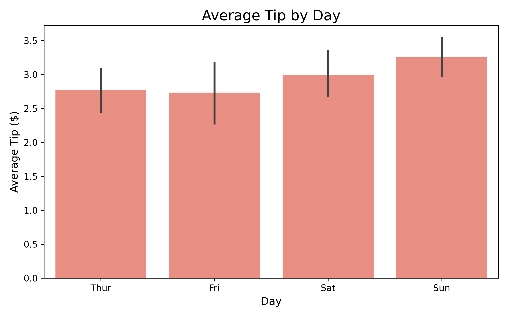
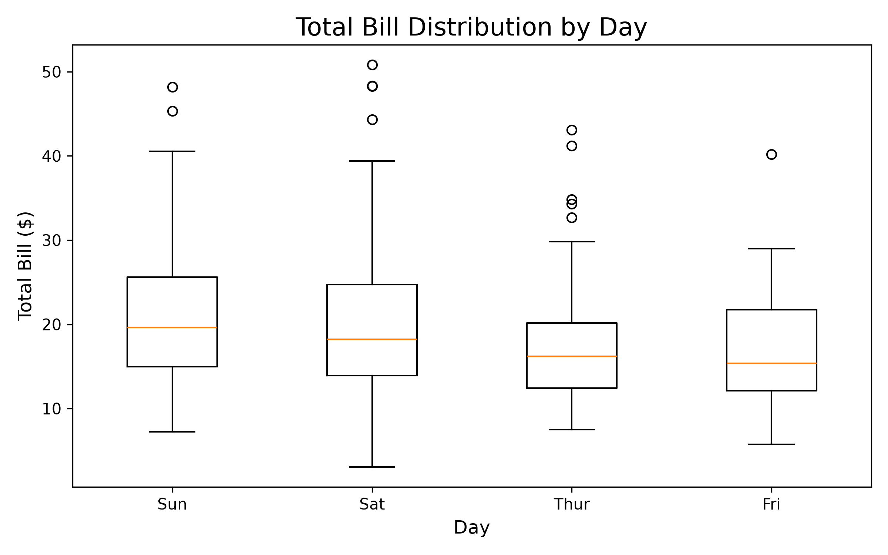
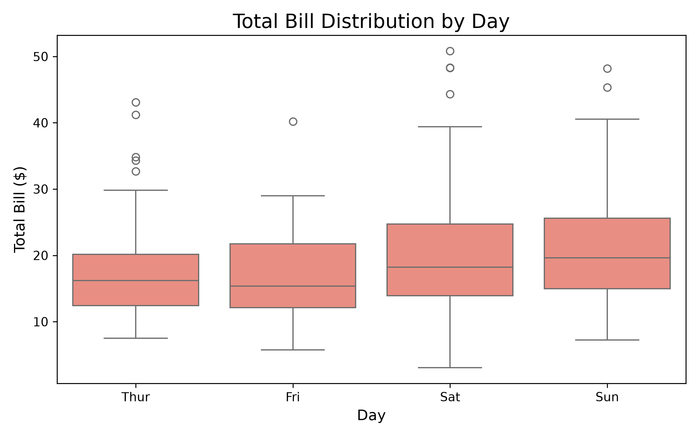
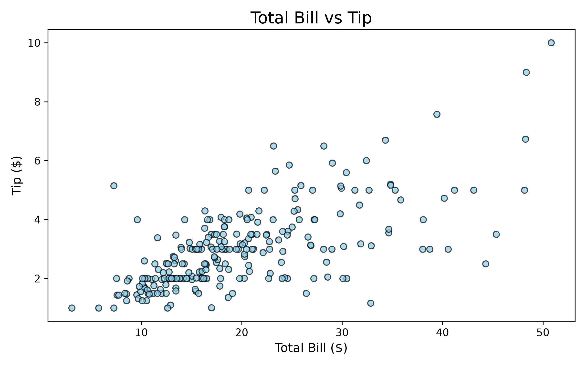
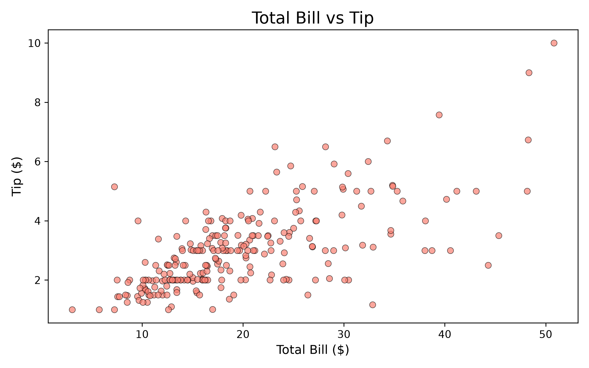
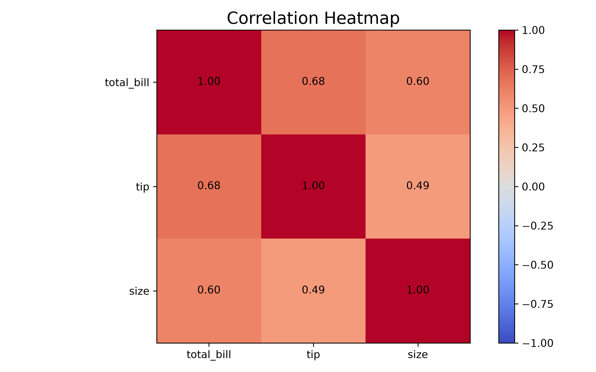
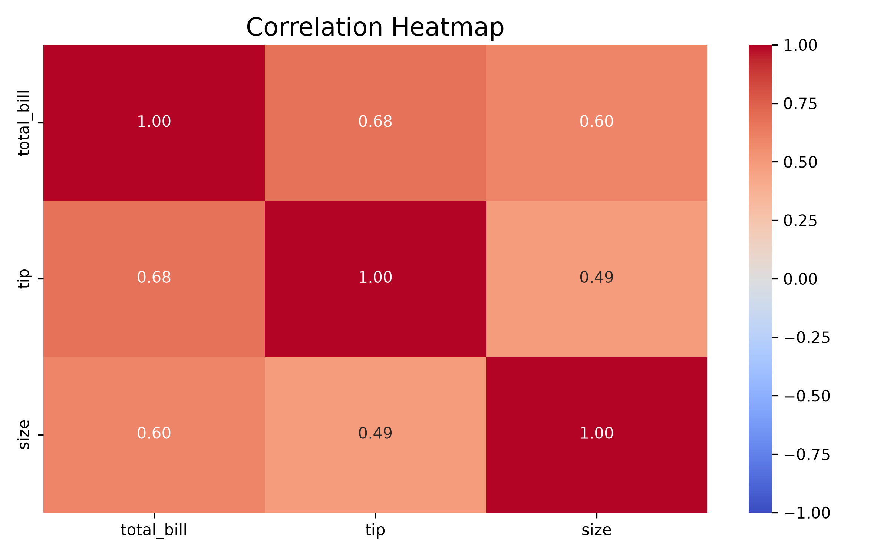

# Data Visualization with Matplotlib and Seaborn

## About

This project focuses on creating different types of visualizations using Matplotlib and Seaborn with the built-in Tips dataset. The goal was to practice creating and customizing charts using both libraries and compare how they work.

Both libraries were used to create the same five types of charts to understand the differences in their syntax and approach.

## How to Run

1. Clone the repository.
2. Navigate to the project directory.
3. Install the dependencies using `uv`.
4. Run the Jupyter Notebook.

```bash
git clone <repository-url>
cd tips-visualization
uv sync
uv lock
```

Open `tips_visualization.ipynb` in Jupyter Notebook.

## Visualization Comparison

### 1. Histogram

**Matplotlib**



**Seaborn**



- Matplotlib uses `plt.hist()` and gives direct control over the histogram settings.
- Seaborn uses `sns.histplot()` and provides a simpler way to create and customize histograms.
- Both produce similar results, but Seaborn offers a more convenient interface.

### 2. Bar Chart

**Matplotlib**



**Seaborn**



- Matplotlib requires calculating the average tip for each day before plotting.
- Seaborn's `sns.barplot()` automatically calculates the average for each category.
- Seaborn makes the process simpler when working directly with a DataFrame.

### 3. Box Plot

**Matplotlib**



**Seaborn**



- Matplotlib requires organizing the data into groups before creating the box plot.
- Seaborn's `sns.boxplot()` works directly with the DataFrame and category columns.
- Seaborn requires less code for grouped box plots.

### 4. Scatter Plot

**Matplotlib**



**Seaborn**



- Matplotlib uses `plt.scatter()` to plot two numerical variables.
- Seaborn uses `sns.scatterplot()` and works directly with DataFrame column names.
- Both provide options to customize colors, transparency and point appearance.

### 5. Correlation Heatmap

**Matplotlib**



**Seaborn**



- Matplotlib uses `plt.imshow()` and requires additional code to display correlation values inside the cells.
- Seaborn's `sns.heatmap()` provides built-in options such as `annot=True` to display values.
- Seaborn makes heatmaps easier to create and customize with less code.

## Project Reference

This project was completed as part of the [Data Visualization Tutorial](https://roadmap.sh/projects/data-visualization-tutorial) project on roadmap.sh.